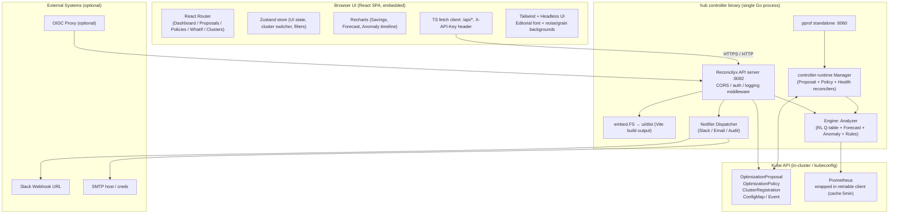

# Technical Architecture — Reconcilyx 2.0 Operator Dashboard (Stage 7)

| Field | Value |
| :--- | :--- |
| Document | Technical Architecture for the Stage 7 Web UI + API |
| Version | 2.0.0 |
| Audience | Engineers extending Reconcilyx |

---

## 1. High-Level Architecture



### 1.1 Ports

| Port | Component | Bind address flag / env |
| :--- | :--- | :--- |
| `8080` or `:8443` | controller-runtime metrics | `--metrics-bind-address` |
| `:8081` | health probe / readiness | `--health-probe-bind-address` |
| `:6060` | pprof | `--pprof-bind-address` / `PPROF_ADDR` |
| `:9443` | admission webhook (Kube API facing) | controller-runtime webhook defaults |
| **`:8082`** | **Reconcilyx API + embedded UI** | **`--api-port`** / `RECONCILYX_API_PORT` |

---

## 2. Backend Stack

### 2.1 Go Packages

```
internal/
├── api/
│   ├── server.go     // HTTP server wire-up, route table, graceful shutdown
│   ├── handlers.go   // GET/POST handlers for all routes
│   ├── middleware.go // CORS, recovery, logging, API-key auth, request ID
│   └── embed.go      // go:embed ui/dist + fallback to index.html for SPA
└── notifiers/
    ├── notifier.go   // Notifier interface + Dispatcher, notification events
    ├── slack.go      // Slack webhook notifier
    ├── email.go      // SMTP notifier (gopkg.in/mail.v2 or stdlib)
    └── audit.go      // Ring buffer audit log + ConfigMap persistence
```

### 2.2 Route Table (port 8082)

| Method | Path | Auth | Purpose |
| :--- | :--- | :--- | :--- |
| `GET`  | `/` | public | serve embedded SPA (`index.html`) |
| `GET`  | `/assets/*` | public | serve bundled Vite static assets |
| `GET`  | `/healthz` | public | liveness |
| `GET`  | `/api/proposals` | API key | list proposals, filter `?phase=&cluster=&namespace=&approvalState=&workload=` |
| `GET`  | `/api/proposals/:name` | API key | proposal detail + related events + conditions |
| `POST` | `/api/proposals/:name/approve` | API key | set `ApprovalState=Approved`, fire ProposalApprovedTotal metric, emit notifications |
| `POST` | `/api/proposals/:name/reject` | API key | set `ApprovalState=Rejected` + `Reason=body.reason` |
| `POST` | `/api/proposals/:name/rollback` | API key | set `Phase=RollingBack`, controller picks up on next reconcile |
| `GET`  | `/api/policies` | API key | list OptimizationPolicies |
| `POST` | `/api/policies` | API key | create a new policy from JSON body (JSON → YAML → Kube Apply via typed object) |
| `GET`  | `/api/metrics/savings` | API key | aggregated monthly savings from Proposal `ExpectedSavingsUSD` |
| `GET`  | `/api/forecast/:workload` | API key | range-series forecast + actual CPU/memory (backed by Prometheus QueryRange + Predictor) |
| `GET`  | `/api/anomalies` | API key | recent AnomalyEventsTotal vector walkback, enriched with workload name |
| `GET`  | `/api/clusters` | API key | list `ClusterRegistration` CRs (hub + spokes) |
| `POST` | `/api/what-if` | API key | body specifies workload + resources, invokes Analyzer offline, returns recommendation + cost impact |
| `GET`  | `/api/audit` | API key | ring buffer audit log tail (10k events), optionally filtered by `?proposal=` |
| `POST` | `/api/webhook/gitops-automerge` | secret-token | reuse existing internal/webhook gitops automerge server at this exposed path too |

### 2.3 Middleware Chain

```
[Request] → RequestID → StructuredLog → RecoverPanic → CORS → RequireAPIKey(publicRoutes whitelisted) → Handler
```

- **CORS**: default allow `localhost:*` + origins from env `RECONCILYX_CORS_ORIGINS`.
- **API key**: read from `X-API-Key` header, compared against `RECONCILYX_API_KEY` env. If env var is empty, warn on startup and allow all requests (dev mode only, banner shown in UI).
- **Request logging**: JSON via `slog`, includes duration, status, method, path, request_id, actor_identified=true/false.
- **Recover**: any panics in handlers return 500, log stack trace, no stack to client.

### 2.4 API → Controller Lifecycle

When a user calls `POST /api/proposals/:name/approve`:
1. Auth middleware verifies the key.
2. Handler fetches the proposal using the manager client.
3. Validates current state (approval must be `Pending` or `Rejected`, not already in `Executing`).
4. Mutates `.status.approvalState = Approved`, `.status.reason = body.Reason`.
5. Writes a kubernetes Event (reason=Approval, actor=api_user).
6. Appends to audit ring buffer.
7. Dispatcher.Notify(ProposalApprovedEvent{Proposal, Actor, Reason}).
8. `telemetry.ProposalApprovedTotal.WithLabelValues(workload, namespace).Inc()`.
9. Returns 200 with the updated resource.
10. ProposalReconciler picks up the approval state change on its next watch event → Scheduled → Executing.

No races: handler fetches → validates → writes Status subresource. Server uses controller-runtime's Status client.

### 2.5 Embed Strategy

- `internal/api/embed.go` declares: `//go:embed all:ui/dist` (relative path resolved from Go module root via a small redirect file in the module root OR use an embed FS in the root package; our approach: embed in `cmd/` via `cmd/main_embed.go` **if** needed — simplest is to define in `cmd/` package with proper relative path since `internal/api` cannot reach `ui/` via relative embed paths).
  Resolved approach: create `cmd/embed.go` with `//go:embed ../ui/dist` → `var UIDist embed.FS`, and pass a reference to the API server constructor. Fallback: if `ui/dist` is absent at build time, the embed will fail — `make build-ui` is a prerequisite of `make docker-build` / `make build` (optionalized via empty FS check).

### 2.6 Notifications

- `Notifier` interface: `Notify(ctx, Event) error`
- `Dispatcher` fans out to registered notifiers.
- Events: `ProposalCreated`, `ProposalApproved`, `ProposalRejected`, `ProposalRolledBack`, `HighAnomalyDetected`.
- Registration on startup from env:
  - `SLACK_WEBHOOK_URL` → registers SlackNotifier (channel overridden via `SLACK_CHANNEL`, default #reconcilyx)
  - `SMTP_HOST`, `SMTP_PORT`, `SMTP_USER`, `SMTP_PASS`, `RECONCILYX_EMAIL_TO` → registers SMTPNotifier
- Notifiers are async fire-and-forget with 5s timeout, errors logged not propagated (notification failures should not block the API call).

### 2.7 Audit Log

- In-memory ring buffer of 10k `AuditEntry{Time, Actor, Action, Proposal, Reason, ClientIP}`.
- `Persister` goroutine snapshots entries every 1 minute to a ConfigMap `reconcilyx-audit-buffer` in `reconcilyx-system`, sharded by hour label. Startup re-hydrates the last 24 hours.

---

## 3. Frontend Stack

### 3.1 Dependencies

```
"react": "^18.3",
"react-dom": "^18.3",
"react-router-dom": "^6.26",
"zustand": "^4.5",
"recharts": "^2.12",
"@tanstack/react-query": "^5.51",
"tailwindcss": "^3.4",
"postcss": "^8.4",
"autoprefixer": "^10.4",
"clsx": "^2.1",
"tailwind-merge": "^2.4",
"@fontsource-variable/instrument-serif": "^5.0",
"@fontsource/sora": "^5.0",
"@fontsource/jetbrains-mono": "^5.0",
"dayjs": "^1.11"
```
Build tool: **Vite 5** + `@vitejs/plugin-react`. Dev proxy on `/api` → `http://localhost:8082`.

### 3.2 Module Structure

```
ui/src/
├── types/index.ts            // ProposalSummary, ProposalDetail, Policy, Cluster, Anomaly, AuditEntry, SavingsPoint
├── api/client.ts             // typed fetch wrappers for every route
├── store/index.ts            // Zustand: { clusterContext, filters, user, apiKey }
├── components/
│   ├── Layout.tsx            // LeftNav + TopBar + Outlet
│   ├── SideNav.tsx
│   ├── TopClusterSwitcher.tsx
│   ├── KPICard.tsx           // 3px colored top border + gradient fill
│   ├── PhaseTimeline.tsx
│   ├── ResourceDeltaCard.tsx // before / after
│   ├── SavingsChart.tsx      // Recharts area
│   ├── ForecastChart.tsx     // dual Y axis CPU + mem actual/predicted
│   ├── AnomalyFeed.tsx
│   ├── ProposalTable.tsx
│   ├── PolicyWizard.tsx      // 6-step form
│   ├── GitOpsCard.tsx
│   ├── ActionModal.tsx       // approve/reject/rollback with reason
│   └── SavingsReservoir.tsx  // hero animated liquid gauge (memorable element)
├── pages/
│   ├── DashboardPage.tsx
│   ├── ProposalsPage.tsx
│   ├── ProposalDetailPage.tsx
│   ├── PoliciesPage.tsx
│   ├── PolicyDetailPage.tsx
│   ├── WhatIfPage.tsx
│   ├── ClustersPage.tsx
│   ├── AnomaliesPage.tsx
│   ├── AuditLogPage.tsx
│   └── SettingsPage.tsx (notifiers, API key status, API base URL)
├── App.tsx
├── main.tsx
└── index.css                 // Tailwind base + editorial fonts + grain texture + theme tokens
```

### 3.3 Data Fetching

- `@tanstack/react-query` (a.k.a. TanStack Query v5) for all `/api/*` calls with:
  - `staleTime: 10s` for list queries
  - `staleTime: 0` (refetch on mount) for Proposal detail (read after write consistency matters for approval)
  - `retry: 2, retryDelay: (n) => 500*2**n`
- Error handling: show inline Alert banner for 4xx + 5xx, do not show stack traces.

### 3.4 Responsive Breakpoints

- Desktop-first: 1280+, laptop (1024-1279), tablet (768-1023). Mobile below 768 gets collapsed nav + scroll tables.
- Desktop default as specified in web-dev skill.

---

## 4. New Environment Variables & CLI Flags

| Name | Default | Purpose |
| :--- | :--- | :--- |
| `--api-port` / `RECONCILYX_API_PORT` | `:8082` | API + UI bind address |
| `RECONCILYX_API_KEY` | unset (dev mode) | API key required if set |
| `RECONCILYX_CORS_ORIGINS` | `http://localhost:5173,http://localhost:8082` | comma-sep allowed origins |
| `SLACK_WEBHOOK_URL` | unset | Slack notifier registration |
| `SLACK_CHANNEL` | `#reconcilyx` | Slack channel |
| `SMTP_HOST` / `SMTP_PORT` / `SMTP_USER` / `SMTP_PASS` | unset | SMTP notifier |
| `RECONCILYX_EMAIL_FROM` / `RECONCILYX_EMAIL_TO` | unset | email subscription list |
| `RECONCILYX_BASE_URL` | `http://localhost:8082` | URL used in notifications to link back to the UI |

---

## 5. Testing Strategy

### Backend Go
- Unit tests in `internal/api/*_test.go` using `net/http/httptest` with a mock controller-runtime client (`sigs.k8s.io/controller-runtime/pkg/client/fake`)
- Coverage focus:
  - Approve/Reject/Rollback validates state transitions correctly
  - What-If endpoint returns the expected Analyzer output shape with no cluster writes
  - API key middleware passes / blocks correctly
  - Audit ring buffer wraps at capacity

### Frontend
- `vitest` + `@testing-library/react` for 4 critical components: KPICard, PhaseTimeline, ProposalTable filters, WhatIfPage sliders → simulate POST.
- Manual end-to-end on Kind via `make demo` after UI build: apply nginx + policy → wait for proposal → open UI at :8082 → approve → verify resources reduced.

---

## 6. Makefile Targets

```makefile
##@ UI / Frontend
.PHONY: build-ui install-ui run-ui-dev run-api embed-ui

install-ui: ## Install Node deps for the dashboard UI
  @cd ui && npm ci || npm install

build-ui: install-ui ## Build the Vite React dashboard
  cd ui && npm run build
  @echo "Wrote UI to ui/dist/ — will be embedded by next go build"

embed-ui: build-ui ## Build UI + run a go vet to ensure embed compiles (UI build → go vet)
  go vet ./cmd/... ./internal/api/...

run-api: manifests generate ## Run the full Go hub controller (metrics + pprof + API + UI)
  go run ./cmd/main.go \
    --metrics-bind-address=":8080" \
    --health-probe-bind-address=":8081" \
    --api-port=":8082" \
    --pprof-bind-address=":6060"

run-ui-dev: install-ui ## Start Vite dev server on :5173 with /api → :8082
  cd ui && npm run dev
```

---

## 7. Security & Permissions

- API server does NOT load kubeadmin credentials — uses the same in-cluster ServiceAccount bound to:
  - `optimizationpolicies`, `optimizationproposals`, `clusterregistrations` (full read)
  - `optimizationproposals/status` (write for approval/rejection state transitions)
  - `configmaps` (read/write in reconcilyx-system for audit buffer)
  - `events` (create/patch)
- No local file writes except stdlib logs.
- If the UI is exposed to untrusted networks, terminate TLS and add OIDC proxy in front. The API key layer is defense-in-depth, not a replacement.
- Embed static files only include hashed asset names; no user-generated content is ever served from the embed FS.

---

## 8. Aesthetic Commitments

1. **No Inter** font. Use **Instrument Serif** for KPIs/display, **Sora** for UI copy, **JetBrains Mono** for code / resource quantities.
2. **No generic purple gradient on white** — dark-mode first with `#0B0F17` base, brand indigo `#6366F1` accents, grain overlay on hero areas.
3. **Savings Reservoir animated gauge** on Dashboard hero — liquid fill, target line, subtle wave animation via SVG `<path>` morph or CSS radial gradients + keyframes.
4. **PhaseTimeline dots** fill sequentially using staggered `animation-delay` when entering the Proposal detail view.
5. **KPICards 3px top-bar semantic color codes** for fast visual pattern matching: green=savings, red=risk, teal=forecast, indigo=operations.
6. **Noise/grain** via `data:` SVG filter or tiny base64 noise PNG at 3% opacity overlay on dashboard surfaces for depth without images.
