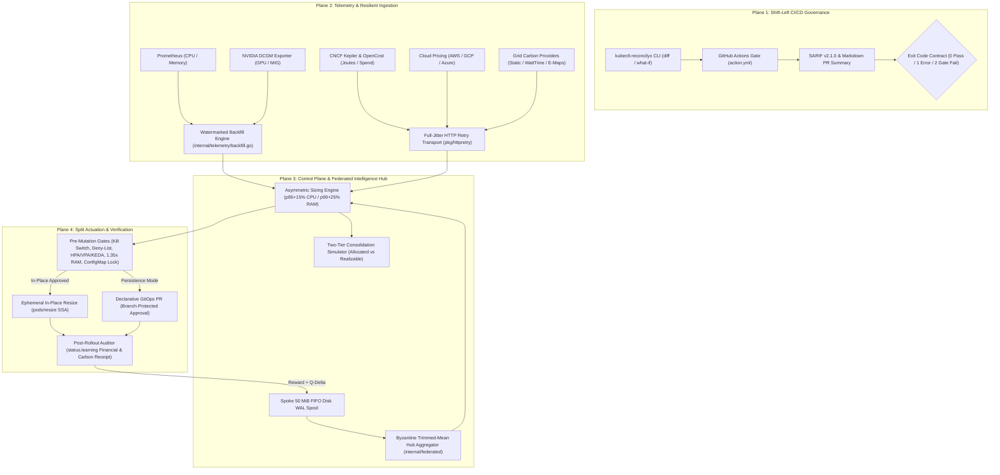
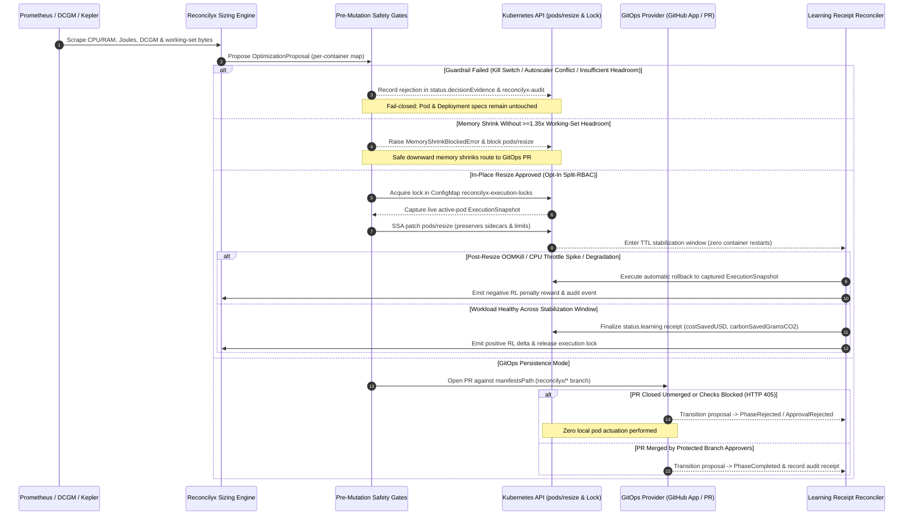
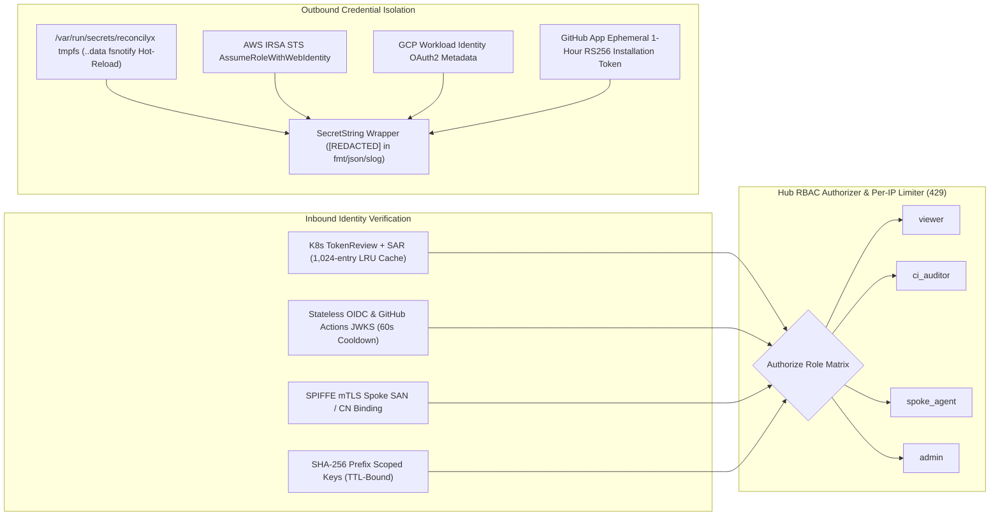
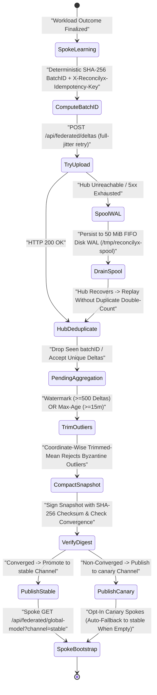
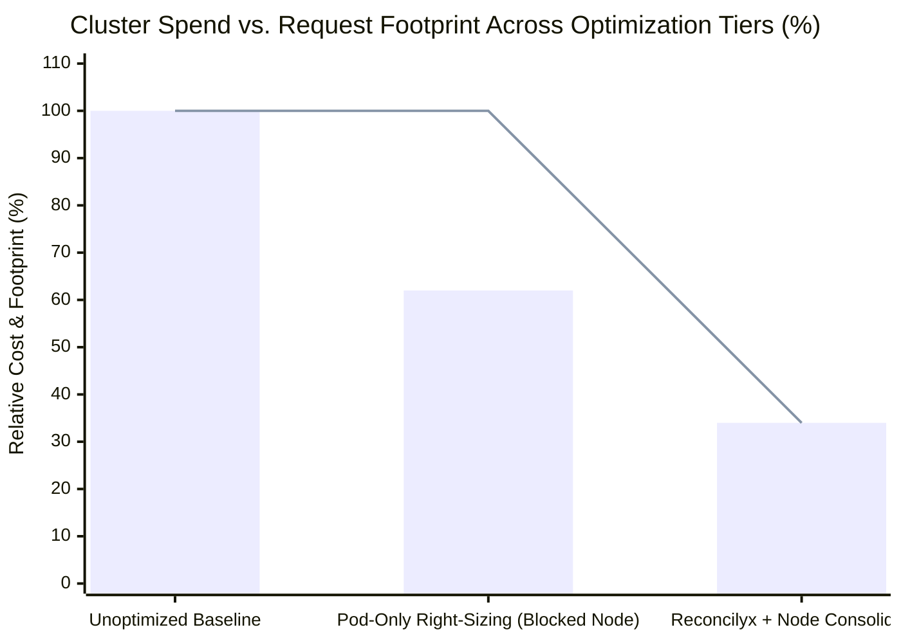
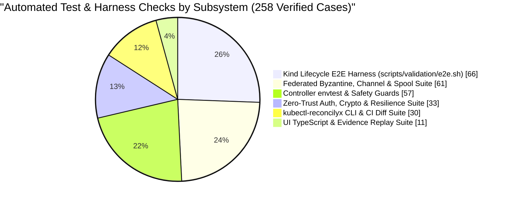

# Reconcilyx

*Autonomous Kubernetes Resource Right-Sizing, Shift-Left FinOps/GreenOps Governance, and Closed-Loop Learning Control Plane*

[](https://github.com/Keninjavelas/Reconcilyx/actions/workflows/build.yml)
[](https://github.com/Keninjavelas/Reconcilyx/actions/workflows/lint.yml)
[](https://github.com/Keninjavelas/Reconcilyx/actions/workflows/test.yml)
[](https://github.com/Keninjavelas/Reconcilyx/actions/workflows/validate-e2e.yml)
[](https://github.com/Keninjavelas/Reconcilyx/actions/workflows/validate-federation.yml)
[](LICENSE)
[](https://reconcilyx.vercel.app/)

---

## 1. Executive Overview: The Problem & How Reconcilyx Solves It

Traditional Kubernetes resource recommenders act as **open-loop, static spreadsheet generators**. In production clusters, that design breaks down in five predictable ways:

1. **Autoscaler Thrashing:** Blindly patching Pod requests while a HorizontalPodAutoscaler (HPA), VerticalPodAutoscaler (VPA), or KEDA `ScaledObject` targets the same workload causes violent scale-and-resize oscillation.
2. **In-Place Memory `OOMKill` Risk:** Naive CPU/memory shrink recommendations applied live without checking active container working-set headroom trigger immediate kernel out-of-memory kills.
3. **The "Paper Savings" Illusion:** Dropping container CPU/memory requests on under-utilized nodes looks good in a UI dashboard, yet zero cloud dollars or watt-hours are saved if PodDisruptionBudgets (PDBs) or topology spread constraints prevent whole-node evacuation and VM termination.
4. **Fire-and-Forget Blindness:** Static recommenders emit a suggested YAML patch and walk away — never auditing whether an applied change actually preserved latency, avoided throttling/OOMs, or delivered realized financial and carbon savings.
5. **Credential & RBAC Sprawl:** Many operators install cluster-wide write permissions by default and rely on a single shared static bearer token for humans, CI pipelines, and spoke agents alike.

**Reconcilyx closes the entire loop** — from pre-merge pull-request gating to guarded in-cluster actuation and post-rollout outcome verification:

- **Shift-Left CI Gate (`kubectl-reconcilyx diff` / `what-if`):** Evaluates Deployment, StatefulSet, and DaemonSet changes before merge against pricing, carbon intensity, and policy guardrails, emitting SARIF v2.1.0 security/FinOps reports, Markdown PR summaries, and deterministic exit codes (`0`, `1`, `2`).
- **Fail-Closed Safety & Split-RBAC Actuation:** Defaults to read-only advisory permissions in Helm (`actuation.inPlaceResizeEnabled: false`). When actuation is enabled, proposals must pass the kill switch, namespace deny-list, workload health gate, autoscaler conflict gate (`HPA`/`VPA`/`KEDA`), execution lock (`ConfigMap/reconcilyx-execution-locks`), and a `1.35x` live working-set headroom check before touching `pods/resize` — or route cleanly through branch-protected GitOps PRs (`ApprovalRejected` on unmerged close).
- **Closed-Loop `status.learning` Receipts & Federated RL:** After a stabilization window backed by Prometheus, Reconcilyx reconciles predicted vs. realized cost, carbon, throttling, and OOM deltas into an immutable `status.learning` receipt and emits federated Q-table deltas protected by Byzantine trimmed-mean outlier rejection.

---

## 2. Plain-English Overview (For Non-DevOps & Executive Stakeholders)

Think of Kubernetes cluster spending like **leasing floors in a commercial office building**:

- Most teams reserve **huge, permanent private suites** (`requests` and `limits`) sized for their busiest Monday of the year, then leave 65% of those desks empty around the clock.
- Standard cost tools hand your facilities team a spreadsheet once a quarter saying *"you could probably shrink Floor 4."* Nobody trusts the spreadsheet enough to touch production, and even if you shrink the suites inside the building, **your rent stays identical unless you can vacate an entire floor and turn off its lights** (realizable node consolidation).
- **Reconcilyx acts as a safety-first building governor:** before new leases are signed in CI, it flags expensive over-provisioning; inside the building, it only trims unused desk capacity when safety sensors confirm nobody is squeezed (`1.35x` memory buffer and active autoscaler checks); afterward, it audits the real utility bill and prints a verified financial + carbon receipt.

### Jargon Translation Table

| Technical Primitive | Plain-English Business Outcome |
|---|---|
| **Workload Right-Sizing** | Continuously matches reserved CPU and memory to real historical demand (`p95 + 15%` CPU, `p99 + 25%` memory) instead of guesswork. |
| **In-Place Pod Resize** | Adjusts live container capacity without restarting pods or dropping customer connections (`zero-restart` Kubernetes `pods/resize`). |
| **HPA/VPA/KEDA Conflict Gate** | Automatically steps aside whenever another autoscaler already controls a service, preventing conflicting automation wars. |
| **GitOps Persistence** | Writes approved resource changes back as audited Pull Requests rather than letting manual changes drift on the next deployment. |
| **`status.learning` Receipt** | An auditable before-and-after financial and carbon ledger attached to every executed change proving whether projected savings materialized. |
| **Byzantine Trimmed-Mean Federation** | Shares sizing experience across clusters while mathematically discarding corrupted or outlier cluster reports before updating the global model. |
| **Watermarked Backfill** | Re-reads missed historical monitoring windows after an outage without ever double-counting past metrics. |

---

## 3. High-Level System Architecture



---

## 4. Closed-Loop Actuation & Safety Lifecycle



---

## 5. Zero-Trust Multi-Identity Security Architecture



### 4-Role Authorization & Blast-Radius Table

| Role | Identity Source | Permitted Endpoints | Blocked Operations | Compromise Containment Guarantee |
|---|---|---|---|---|
| **`viewer`** | Scoped UI key, OIDC group, or K8s ServiceAccount (`get` SAR) | `GET /api/proposals`, `GET /api/metrics/savings`, `GET /api/policies`, `POST /api/chat` (read tools) | `/api/what-if`, `/api/v1/diff`, approvals, rollbacks, compaction, `/api/federated/deltas` | Read-only observability; cannot approve, mutate pods, trigger backfills, or poison federated learning. |
| **`ci_auditor`** | GitHub Actions OIDC JWT (`github-oidc`) or CI scoped key | All `viewer` routes plus `POST /api/what-if`, `POST /api/v1/what-if`, `POST /api/v1/diff` | Approvals, reject, rollback, compaction, delta upload, telemetry backfill | Scoped strictly to shift-left PR cost/carbon analysis; CI runner compromise cannot actuate cluster state. |
| **`spoke_agent`** | SPIFFE mTLS SAN/CN certificate or cluster-bound spoke key | `POST /api/federated/deltas`, `POST /api/v1/federation/deltas`, `GET /api/federated/global-model`, `GET /api/v1/federation/snapshots` | `GET /api/proposals`, approvals, `POST /api/v1/federation/compact`, cross-cluster delta spoofing (`403`) | Enforces cluster-name identity binding (`ValidateSpokeClusterBinding`); a compromised spoke cannot spoof peers or approve workloads. |
| **`admin`** | Admin scoped key, OIDC admin group, or K8s cluster-admin `TokenReview` | Full control plane: approvals, reject, rollback, compaction, canary demotion, `POST /api/v1/telemetry/backfill` | Unauthenticated/unsigned webhook calls still blocked; actuation still bound by Helm RBAC | Even full `admin` API access cannot bypass read-only Helm Split-RBAC unless `pods/resize` is explicitly opted in. |

---

## 6. Hub-and-Spoke Federated Learning & Pipeline Resilience



### Watermarked Historical Telemetry Backfill

When Prometheus scrapes or connectivity suffer an outage window, operators or automation can recover historical utilization windows cleanly via:

```bash
kubectl-reconcilyx backfill -n production --from 2026-11-14T00:00:00Z --to 2026-11-14T06:00:00Z --step 5m
```

- **Monotonic Per-Namespace Watermarks:** Tracks the latest evaluated timestamp per namespace in `BackfillEngine` and exposes `POST /api/v1/telemetry/backfill` (`RoleAdmin` only).
- **Zero Double-Counting Guarantee:** Each reconstructed window bucket is keyed idempotently by `sha256(workloadUID | windowStartUnix)` and capped by a bounded processed-window cache (`100,000` entries), incrementing `reconcilyx_pipeline_backfill_deduped_total` whenever an already-ingested interval is replayed.

---

## 7. Quantitative Architecture Charts

### The "Paper Savings" Trap vs. Two-Tier Node Consolidation

`EvaluateNodeWithConstraints` explicitly separates **allocated container request reductions** (`AllocatedSavingsUSD`) from **whole-node realizable VM and carbon reductions** (`RealizableNodeSavingsUSD`) after checking PodDisruptionBudgets and topology spread constraints (`% of baseline monthly node cost`):



*Bars represent reserved container CPU/memory footprint (`100%` -> `62%` -> `34%`); the overlaid line tracks actual cloud infrastructure billing (`100%` unchanged when PDB/spread constraints block evacuation vs. `34%` when whole under-utilized nodes terminate).*

### Automated Verification Coverage Across the Repository



*(Note: Engine, cloud pricing, carbon, policy, LLM, GitOps, and backfill domain packages carry an additional `135` unit tests executed under `go test -race`, alongside [helm_template_test.sh](charts/reconcilyx/tests/helm_template_test.sh) CI assertions.)*

---

## 8. Competitive Landscape Comparison Matrix

| Capability | Reconcilyx | Goldilocks / Native VPA | Robusta KRR | OpenCost / Kubecost | Infracost | Commercial SaaS (Cast AI / ScaleOps) |
|---|---|---|---|---|---|---|
| **Primary Focus** | Closed-loop right-sizing, shift-left CI gates & learning receipts | In-cluster CPU/RAM recommendation hints | Static CLI cluster right-sizing scan | Cost allocation & chargeback visibility | Terraform HCL PR cost estimates | Managed black-box cluster & node autoscaling |
| **HPA / VPA / KEDA Conflict Rejection** | **Fail-closed JIT gate** (`AutoscalerConflictGate` + KEDA `ScaledObject` check) | Manual operator avoidance | Advisory warning flags only | Read-only visibility (no actuation) | Not runtime-aware (IaC only) | Proprietary controller rules |
| **In-Place `pods/resize` + `1.35x` RAM OOM Guard** | **Yes** (`Apply` SSA + `MemoryShrinkBlockedError` `<1.35x` working set) | VPA evicts & recreates Pods (in-place alpha/external) | No actuation (read-only CLI) | No in-place pod resize | No runtime pod resize | Varying proprietary pod eviction / resize agents |
| **Closed-Loop Predicted vs. Realized `status.learning` Receipts** | **Yes** (live-pod snapshot + 5m Prometheus window + RL variance) | No post-rollout savings receipt | No post-rollout verification | Retrospective billing without per-proposal variance | Pre-apply estimate only | SaaS vendor dashboard estimates |
| **Shift-Left CI Gate (`diff` / `what-if` + SARIF v2.1.0 + Exit `2`)** | **Yes** (offline/online `diff`, SARIF v2.1.0, Markdown, exit code `2`) | None (in-cluster only) | CLI scan (no Kubernetes manifest SARIF git diff) | Limited CI cost reporting | Strong Terraform HCL (`diff`), not K8s pod/carbon/guardrails | Primarily runtime cluster agents |
| **Byzantine-Resilient Multi-Cluster Federated Learning** | **Yes** (trimmed-mean outlier rejection, 50 MiB WAL, `stable`/`canary`) | Single-cluster only | Single-context scan per run | Multi-cluster cost rollup only (no RL sync) | Stateless CLI | Multi-cluster control loops hosted on vendor SaaS |
| **Energy & GPU Telemetry (Kepler eBPF + NVIDIA DCGM)** | **Yes** (DCGM SM clock/MIG/FB + Kepler Joules + grid carbon fallback) | CPU/Memory only | CPU/Memory focus | Basic GPU/carbon extensions | None (pricing focus) | Basic GPU utilization metrics |
| **License & Self-Hosted Zero-Telemetry Control** | **Apache 2.0**, 100% self-hosted Hub & CLI (zero phone-home) | Apache 2.0, self-hosted | MIT, self-hosted CLI | Apache 2.0 core / commercial enterprise tiers | Apache 2.0 CLI + SaaS API | Closed-source commercial SaaS subscription |

---

## 9. CLI Reference (`kubectl-reconcilyx`) & Shift-Left CI/CD Integration

| Command | Purpose | Key Flags | Exit Code Contract |
|---|---|---|---|
| `scan` | List Hub optimization proposals, approval/phase status, projected savings, and carbon impact | `-n, --namespace`, `-o table\|json\|markdown\|sarif` | `0` Success • `1` Transport / Auth / Malformed Hub Error |
| `explain <proposal>` | Inspect a single proposal's policy decision evidence, events, and predicted-vs-realized `status.learning` variance | `-n, --namespace`, `-o table\|json\|markdown\|sarif` | `0` Success • `1` Proposal Not Found / Ambiguous / API Error |
| `what-if` | Simulate cost delta (`costDeltaUSDPerMonth`), risk score, confidence, and policy allowance before applying | `--current-cpu`, `--current-memory`, `--proposed-cpu`, `--proposed-memory`, `--p95-cpu`, `--p95-memory`, `--fail-on`, `-o` | `0` Allowed • `1` API/Input Error • **`2` `--fail-on` Gate Triggered** |
| `diff` | Compare Deployment, StatefulSet, and DaemonSet manifests vs. git `--base` ref or `--base-manifests` with cost, carbon & guardrails | `--manifests`, `--base`, `--base-manifests`, `--offline`, `--region`, `--min-replicas`, `--max-replicas`, `--max-increase-percent`, `--fail-on`, `-o` | `0` Clean • `1` Git/YAML Error • **`2` Policy Gate Triggered** |
| `backfill` | Trigger idempotent Prometheus range recovery for missed telemetry intervals (requires `RoleAdmin`) | `-n, --namespace`, `--from` (RFC3339), `--to` (RFC3339), `--step` (default `5m`), `-o table\|json` | `0` Backfilled • `1` Validation / RBAC (`403`) / Hub Error |

*(All Hub-connected commands inherit `-s, --server` defaulting to `http://localhost:8082`, `-t, --token`, and kubeconfig token forwarding.)*

### CLI Examples

```bash
# Offline shift-left diff emitting SARIF v2.1.0 and failing on cost/carbon increases or missing requests
kubectl-reconcilyx diff --manifests deploy/ --base origin/main --offline \
  --fail-on cost-increase,carbon-increase,guardrail -o sarif > reconcilyx.sarif

# Pre-change what-if simulation failing when risk >= 70 or spend increases
kubectl-reconcilyx what-if --current-cpu 500m --current-memory 256Mi \
  --proposed-cpu 250m --proposed-memory 128Mi --fail-on "cost-increase,risk>=70"

# Live cluster proposal report and realized-vs-predicted audit receipt
kubectl-reconcilyx scan -n production -o markdown
kubectl-reconcilyx explain web-rightsize-7f2c -n production -o markdown
```

### 5-Line GitHub Action Integration (`action.yml`)

Use the composite action at [action.yml](action.yml) (or [.github/actions/reconcilyx-gate/action.yml](.github/actions/reconcilyx-gate/action.yml)) to automatically populate `$GITHUB_STEP_SUMMARY` with a Markdown cost/carbon table and upload SARIF v2.1.0 findings to GitHub Code Scanning:

```yaml
- uses: Keninjavelas/Reconcilyx@main
  with:
    manifests: deploy/
    fail-on: cost-increase,carbon-increase,guardrail
- uses: github/codeql-action/upload-sarif@v3
  if: always()
  with:
    sarif_file: reconcilyx-diff.sarif
```

---

## 10. Operator Console & Transparent Evidence Replay Mode

The React TypeScript dashboard (`ui/`) operates cleanly in two explicit modes with **zero fabricated metrics**:

1. **Embedded / Live Connected Mode (`:8082`):**
   - Embedded directly in the Go Hub binary via `go:embed` so operators browsing `http://<hub-host>:8082/` authenticate on the same origin with zero CORS friction.
   - Standalone static builds can attach to any private or VPS Hub via the interactive **Connect Live Hub** modal ([HubConnectionModal.tsx](ui/src/components/HubConnectionModal.tsx)) or **Settings → Control Plane API**, using scoped API keys or OIDC tokens and explicit `RECONCILYX_CORS_ORIGINS` allow-listing.
2. **Read-Only Evidence Replay Mode ([`https://reconcilyx.vercel.app/`](https://reconcilyx.vercel.app/)):**
   - Because Reconcilyx deliberately does **not** run a public mutating backend cluster, visiting the static Vercel deployment boots into **Read-Only Evidence Replay Mode** under an unmistakable top banner (`EVIDENCE REPLAY MODE`).
   - All charts, proposals, savings (`$18.25`, `4.2 kg CO₂`), and cluster rows replay immutable artifacts captured directly from verified CI and Kind TLS runs (`#20261026055631`, `#43612195251`, `#43612195323`, and `PR #4`), while every mutation control (`Approve`, `Reject`, `Rollback`) fails closed until the user connects a real Hub endpoint.

---

## 11. Deployment, Infrastructure as Code (Terraform) & SRE Operations

| Model | Artifact Path | Key Guardrails & Features |
|---|---|---|
| **Helm Split-RBAC In-Cluster** | [charts/reconcilyx](charts/reconcilyx) | Defaults `actuation.inPlaceResizeEnabled: false` (omits `pods/resize` `patch` RBAC completely in advisory mode); bundles CRDs in `charts/reconcilyx/crds/`; supports `PodDisruptionBudget`, `HorizontalPodAutoscaler`, `NetworkPolicy`, `PrometheusRule`, projected `tmpfs` secret mounts, and `tests/test-connection.yaml`. |
| **Declarative Terraform / OpenTofu** | [deploy/terraform/](deploy/terraform/) | Supports `cloud_provider` profiles `aws-eks` (IRSA `eks.amazonaws.com/role-arn`), `gcp-gke` (Workload Identity `iam.gke.io/gcp-service-account`), and `generic-kubeconfig`; remote encrypted state locking templates (`backend.tf.example` for S3+DynamoDB & GCS); enforces namespace `pod-security.kubernetes.io/enforce=restricted`; atomic Helm rollback (`atomic = true`, `cleanup_on_fail = true`). |
| **Embedded / VPS Container** | [Dockerfile](Dockerfile) & [docs/DEPLOYMENT.md](docs/DEPLOYMENT.md) | Three-stage static distroless build (`CGO_ENABLED=0`, `-ldflags="-s -w"`, non-root `65532:65532`) behind Caddy or Nginx TLS 1.3; configured with `RECONCILYX_API_KEY` / scoped keys and `RECONCILYX_CORS_ORIGINS`. |

### 3:00 AM SRE Runbook & Observability (`docs/RUNBOOK.md`)

- **W3C Distributed Tracing (`pkg/tracing`):** Propagates `traceparent` and `X-Request-ID` headers across the Hub API middleware, `slog` structured logs, outbound `pkg/httpretry` calls, and `kubectl-reconcilyx` CLI requests for instant log-to-request correlation.
- **Bundled `PrometheusRule` Alerts ([prometheusrule.yaml](charts/reconcilyx/templates/prometheusrule.yaml)):** Every alert embeds a direct `runbook_url` into [docs/RUNBOOK.md](docs/RUNBOOK.md):
  1. `ReconcilyxFallbackModeSustained` (`reconcilyx_pipeline_fallback_active == 1` for `15m`)
  2. `ReconcilyxSpokeSpoolBacklogCritical` (`reconcilyx_spoke_spool_queued_batches > 20` for `10m`)
  3. `ReconcilyxRetryStormDetected` (`rate(reconcilyx_pipeline_retries_total[5m]) > 1` for `10m`)
  4. `ReconcilyxControllerPodCrashLoop` (`kube_pod_container_status_restarts_total` `manager > 2` in `15m`)
  5. `ReconcilyxAutomatedRollbacksSpike` (`increase(reconcilyx_rollback_total[30m]) > 2`)
- **Security Threat Model:** Detailed trust boundaries, key rotation, webhook HMAC replay protection, and RBAC attack-tree mitigations live in [docs/THREAT_MODEL.md](docs/THREAT_MODEL.md).

---

## 12. Verification Evidence, Release Posture & Development Guide

Reconcilyx enforces a strict, zero-fabrication evidence policy: maintainer CI runs are verified against live Kind clusters, envtest, live public endpoints, and contract harnesses (`88 Verified`), while external cloud billing APIs, physical NVIDIA GPUs, and user-managed EKS/GKE/scale clusters are explicitly delineated as **BYOK / Hardware-Gated / User-Provisioned (`14 Contract-Verified`)** with **`0 Missing`** capabilities in [FEATURE_MATRIX.md](FEATURE_MATRIX.md). **Project Status: ACTIVE — Release Verified (`2026-11-15`)**, exiting the historical [HIATUS.md](HIATUS.md) checklist.

### Release & Verification Status

| Domain / Gate | Status | Evidence & Reference |
| --- | --- | --- |
| **Core GitHub-Hosted CI & Container/Helm Release (`H-01`)** | **Verified in CI** (`v4.1.0-rc1`) | **9/9** GitHub Actions workflows green on commit `01fa68a` (`Build` `43679357539`, `Lint & Security` `43679357529` with `gitleaks`/`govulncheck`/`trivy`, `Test` `-race` `43679357537`, `E2E Tests` `43679357781`, `Validate E2E Harness` `43679357860`, `Validate Federation E2E` `43679357532`, `Release` `43679362365`, `Publish container image` `43679362201`, tag `E2E Tests` `43679362220`); 14 assets + Cosign signature published on pre-release `v4.1.0-rc1`. |
| **66-Check Single-Node & 3-Node TLS Kind E2E** | **Verified in Kind + CI** | `scripts/validation/e2e.sh` (`20261024155951` & 3-node TLS `multinode-tls-20261026055631` through ingress-nginx): 66/66 checks passing, sidecar preservation, unchanged pod UIDs, zero restarts, finalized `costSavedUSD=4106m` receipt, and 9/9 TLS 1.3 probes; reproduced in CI (`43679357860`). |
| **Two-Cluster Kind Federated Rollout (`H-07`)** | **Verified in CI** (`2026-11-14`) | `.github/workflows/validate-federation.yml` (`43610765983` & `43679357532`): Kind v1.37.0 Hub + Spoke compacted `v2` (`modelHash: b3277814cf4dbbfe`, `outlierRejectedCount: 1`), `stable`/`canary` header routing, and Spoke bootstrap. |
| **Branch-Protected GitOps PR Lifecycle (`H-06`)** | **Verified Live on GitHub** (`2026-11-14`) | `Keninjavelas/Reconcilyx` PR `#4` against branch-protected `gitops-protected-target` (`build` required check `132498371777` `success`, `1` required approval, `enforce_admins: true`): `AutoMerge` blocked (`405`), closed unmerged -> `PhaseRejected` with workload `cpu-burner` untouched (`500m`/`128Mi`). |
| **Azure Pricing, AWS/GCP Billing & Carbon (`H-02`, `H-03`, `H-10`)** | **Closed / Contract-Verified (BYOK)** (`2026-11-15`) | Live unauthenticated Azure Retail Prices API verified (`Standard_D2s_v5`/`eastus` `$0.096/h`, `Standard_F2s_v2`/`eastus` `$0.0846/h`); `./internal/cloud/...` (`20.243s`) passes AWS SigV4 + IRSA STS, GCP Catalog SKU pagination + OAuth2 Workload Identity, retry backoff, and `static-fallback`. Live AWS/GCP/carbon (`RECONCILYX_CARBON_PROVIDER`) paths remain operator **BYOK**. |
| **Static Console Evidence Replay & Hosting (`H-05`)** | **Closed / Live (`HTTP 200`)** | [`https://reconcilyx.vercel.app/`](https://reconcilyx.vercel.app/) serves the static **Read-Only Evidence Replay** UI (`#20261026055631`, `#43612195251`, `#43612195323`, `PR #4`) + **Connect Live Hub** modal; no public mutating backend Hub is operated (Hub hosting is self-hosted by operators). |
| **Multi-Cluster Cloud TLS, E2E & Scale (`H-04`, `H-08`, `H-12`)** | **Closed / User-Provisioned Infrastructure** (`2026-11-15`) | Parameterized `deploy/terraform/` EKS/GKE blueprints + Helm HA charts + Kind 3-node TLS/2-cluster Kind federation proof satisfy maintainer scope; live EKS/GKE/load-test soak runs activate on user-provisioned cloud clusters (`H-12` exits hiatus at `88 / 14 / 0`). |
| **GPU Telemetry & NVIDIA DCGM (`H-09`)** | **Closed / Contract-Verified (Hardware-Gated)** (`2026-11-15`) | `./internal/telemetry/...` (`1.264s`) and `./internal/engine/...` (`0.366s`–`1.694s`) verify `DCGM_FI_DEV_*` parsing, `MIGProfile` (`nvidia.com/mig-1g.5gb`), Kepler/OpenCost adapters, idempotent backfill watermarks, GPU buckets, and OOM headroom; live scraping is **Hardware-Gated**. |
| **White-Box Security Audit Dossier (`H-11`)** | **Closed / Dossier Published** (`2026-11-15`) | Published [docs/SECURITY_AUDIT.md](docs/SECURITY_AUDIT.md) mapping [docs/THREAT_MODEL.md](docs/THREAT_MODEL.md) STRIDE boundaries to passing `pkg/security/...`, `internal/api/...`, `pkg/httpretry/...`, and `internal/webhook/...` suites plus CI `gosec`/`govulncheck`/`Trivy`/Cosign runs (`docs/THREAT_MODEL.md` compliant; third-party SOC2/pentest optional per operator). |

### Local Build, Test & E2E Instructions

The Go binary embeds `ui/dist`, so build the frontend before compiling Go:

```bash
# 1. Typecheck, unit-test, and bundle the React console
cd ui
npm ci
npm run typecheck
npm test
npm run build
cd ..

# 2. Build binaries and run Go race-enabled unit & envtest suites
go build ./...
make test

# 3. Validate Helm chart manifests & Split-RBAC defaults
bash charts/reconcilyx/tests/helm_template_test.sh

# 4. Run full Kind + Prometheus lifecycle E2E or two-cluster federation E2E (requires Docker)
make validate-e2e
bash scripts/validation/federation-e2e.sh
```

For UI development (`http://localhost:5173`), `npm run dev` proxies `/api/*` requests to `http://localhost:8082` (configurable via `VITE_API_BASE` or `RECONCILYX_API_URL`; see [ui/README.md](ui/README.md)). Full phase and gate records live in [STATUS.md](STATUS.md), [FEATURE_MATRIX.md](FEATURE_MATRIX.md), [GITHUB_ISSUES.md](GITHUB_ISSUES.md), and [HIATUS.md](HIATUS.md).

### License

Reconcilyx is open-source software licensed under the [Apache License 2.0](LICENSE). The license permits commercial use, modification, distribution, and sublicensing subject to its terms and notice requirements; the project provides no hosted SLA, security certification, or warranty.
