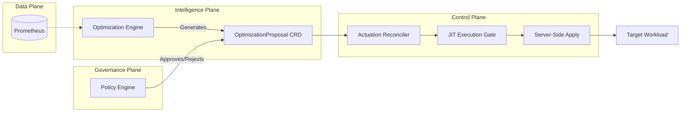

  
# Reconcilyx

**Autonomous, Safety-First Kubernetes Workload Optimization**

*Reconcilyx safely closes the loop between Kubernetes observability and actuation using a strictly governed, Server-Side Apply policy engine.*

---

## 1. What is Reconcilyx?
Reconcilyx is the first operator to leverage Kubernetes **In-Place Pod Resizing** to reduce cloud costs without a single pod restart. 

Unlike VPA, which relies on rolling updates (restarts), Reconcilyx patches the running pod's resource allocation directly using the `InPlacePodVerticalScaling` feature gate. It uses predictive ML to forecast usage 24 hours ahead, automatically rolls back changes the moment a workload shows stress, and yields gracefully to GitOps tools using exponential backoff. 

If it cannot predict safely, it does nothing—because saving money is worthless if you break production.

## 3. Architecture

## 4. Core Innovations
- **Decoupled Evaluation:** Telemetry collection, risk scoring, policy approval, and actuation are completely isolated states.
- **GitOps Yielding:** Reconcilyx never fights ArgoCD. If an external tool reverts an optimization, Reconcilyx detects the mismatch and permanently yields, preventing API Server ping-pong thrashing.
- **Optimistic Execution Locks:** Prevents concurrent controllers from corrupting workload state via the `reconcilyx.io/execution-lock` annotation.

## 5. Safety Mechanisms
1. **Execution Snapshots:** Precisely 1 millisecond before mutating a workload, Reconcilyx takes a deep copy of the `Generation` and `ResourceVersion`. This guarantees mathematically perfect rollbacks that do not accidentally erase manual edits.
2. **Server-Side Apply Granularity:** The Actuator constructs raw, unstructured JSON payloads targeting *only* `requests.cpu` and `requests.memory`. It is physically incapable of mutating images, limits, or labels.
3. **Global Kill-Switch:** A dedicated `reconcilyx-config` ConfigMap can instantly freeze all cluster mutations (`actuation_paused: "true"`), downgrading Reconcilyx to a read-only Dry Run mode.

## 🚀 The 15-Minute Test Harness (Phase 5 Demo)