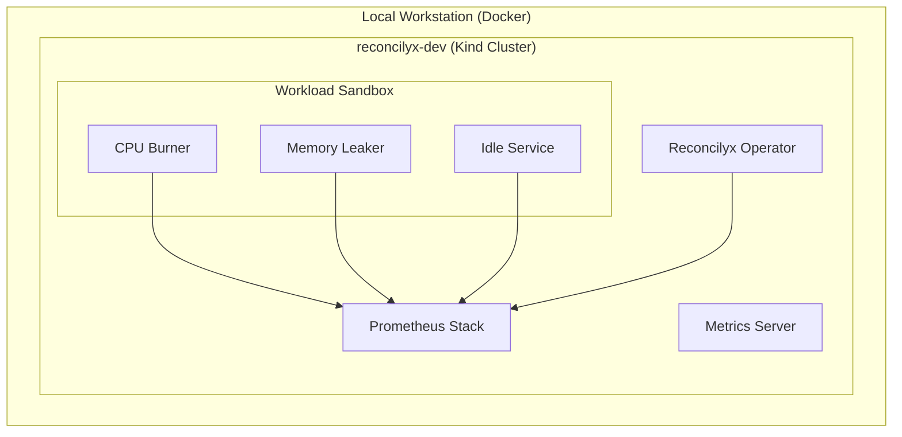

# Reconcilyx Local Development Guide

This document describes how to boot, manage, and tear down the local Kubernetes platform environment for Reconcilyx. 

## Architecture Overview

The local environment is entirely self-contained within a `Kind` (Kubernetes IN Docker) cluster. 



## Prerequisites

> [!WARNING]
> **Windows Users:** The local environment scripts and `Makefile` rely heavily on `bash` and standard Unix tools. You MUST execute all local platform commands (e.g., `make dev-up`) from within a WSL (Windows Subsystem for Linux) distribution (like Ubuntu) or a native Linux/macOS environment. Running these commands directly in native Windows PowerShell will fail.

Ensure the following tools are installed on your workstation (inside WSL if on Windows):
- **Docker** (or Docker Desktop)
- **Kind** (`go install sigs.k8s.io/kind@latest`)
- **Helm** (`brew install helm` or equivalent)
- **Kubectl**
- **Make**

## Startup Flow

To build the operator, compile the workloads, start the cluster, and install all observability components, run:

```bash
make dev-up
```

This command will:
1. Create a Kind cluster named `reconcilyx-dev`.
2. Install `metrics-server` (with insecure TLS for local dev).
3. Install the `kube-prometheus-stack` via Helm into the `monitoring` namespace.
4. Install Reconcilyx CRDs (`OptimizationPolicy` and `OptimizationProposal`).
5. Build the Operator Docker image and load it into the Kind cluster.
6. Deploy the Reconcilyx Operator.
7. Deploy the dummy workload sandbox applications (cpu-burner, memory-leaker, idle-service).

## Expected Cluster State

After a successful `make dev-up`, you should see:
- Operator pod running in `reconcilyx-system` namespace.
- Prometheus stack pods running in `monitoring` namespace.
- Workload sandbox pods running in `reconcilyx-system` namespace.

```bash
kubectl get pods -A
```

## Accessing Observability (Grafana & Prometheus)

To view metrics, port-forward the Prometheus or Grafana services:

**Grafana:**
```bash
kubectl port-forward svc/prometheus-grafana -n monitoring 3000:80
```
- Access at `http://localhost:3000`
- Default login: `admin` / `prom-operator`

**Prometheus:**
```bash
kubectl port-forward svc/prometheus-kube-prometheus-prometheus -n monitoring 9090:9090
```
- Access at `http://localhost:9090`

## Teardown Flow

To safely tear down the environment and clean up all resources:

```bash
make dev-down
```

## Troubleshooting

- **Cluster fails to create**: Ensure Docker Desktop is running and has sufficient resources allocated (minimum 4GB RAM).
- **Metrics not showing in Prometheus**: Check if the `ServiceMonitor` resources are applied and have the `release: prometheus` label.
- **ImagePullBackOff for Operator**: Ensure `make kind-push` executed successfully before deploying.
