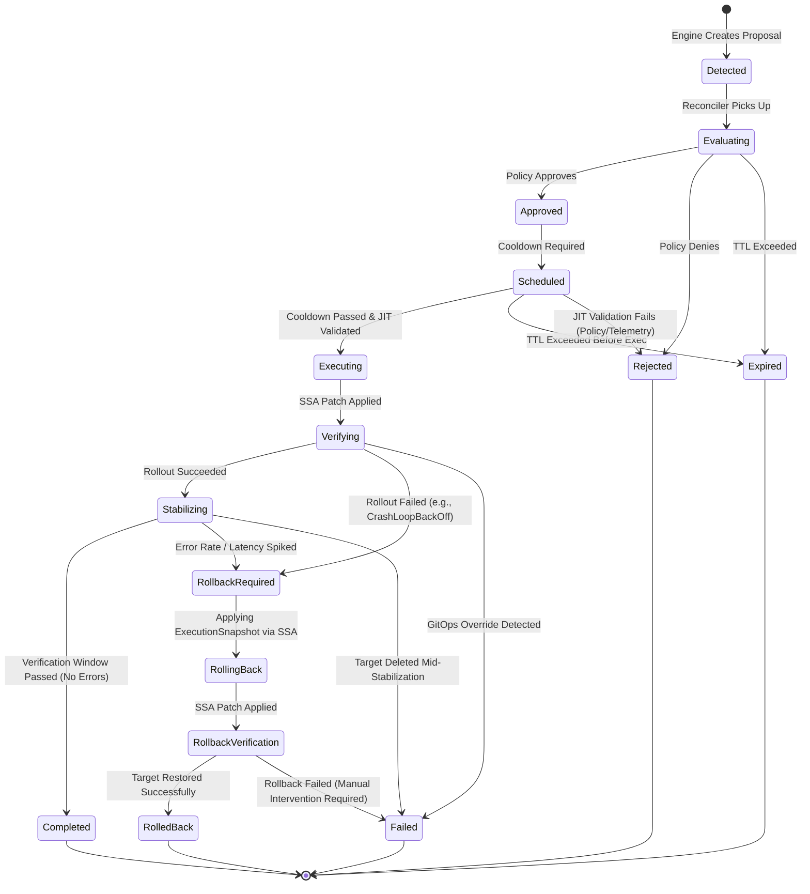

# Proposal State Machine V2

This document defines the strict lifecycle and state transitions for the `OptimizationProposal` custom resource. Actuation must conform strictly to these phases to guarantee safe mutations and auditable rollbacks.

## 1. State Diagram

## 2. Invariants

1. **Monotonic Progression (Mostly):** A proposal generally moves forward. A `Rejected` or `Completed` proposal NEVER re-enters `Executing`. 
2. **Snapshot Mandate:** A proposal CANNOT transition from `Scheduled` to `Executing` unless `Status.ExecutionSnapshot` is fully populated.
3. **Immutability of Terminal States:** Once a proposal hits a terminal state (`Rejected`, `Completed`, `Failed`, `Expired`, `RolledBack`), the Reconciler must ignore it.
4. **GitOps Yield:** If ArgoCD or Flux overwrites the `resources` map during `Verifying` or `Stabilizing`, the Reconciler MUST instantly transition to `Failed: GitOpsOverride` and cease fighting.

## 3. Recovery Paths

- **Stuck in `Executing`:** If the Reconciler crashes midway through `Executing`, the next loop will see the current state versus the intended state. If drift exists, it assumes GitOps override.
- **`RollbackVerification` Failure:** If a rollback fails to stabilize, it transitions to `Failed`. This is a critical alert scenario indicating human intervention is required, as the Reconciler cannot mathematically restore the pod.
