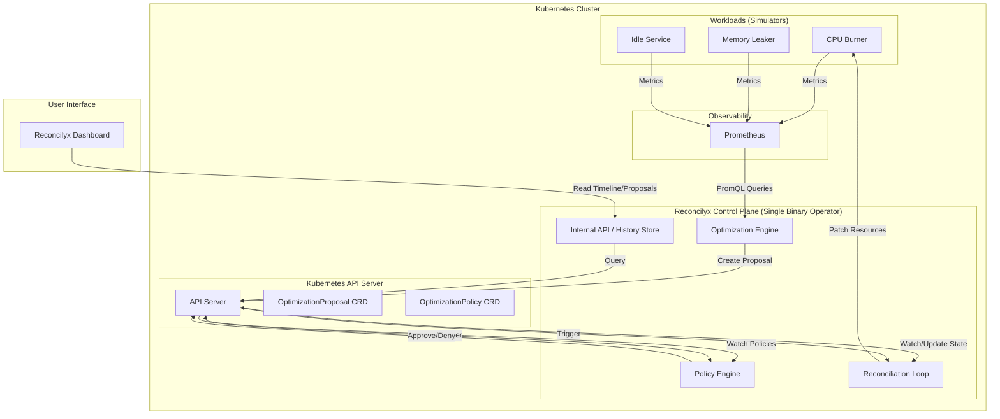

# Reconcilyx System Design

## High-Level Architecture Diagram

## Detailed Component Breakdown

### 1. The Reconcilyx Operator (Monolithic Control Plane)
To avoid microservice bloat, the core intelligence is packaged as a single Go binary leveraging `controller-runtime`.
* **Optimization Engine Module**: Runs background workers that periodically evaluate namespaces. It runs PromQL queries to determine actual usage vs. requested limits.
* **Policy Engine Module**: A lightweight evaluation layer that reads `OptimizationPolicy` CRDs and applies rules (e.g., `requireApproval: true`, `maxReductionPercent: 20`) to incoming proposals.
* **Reconciliation Loop Module**: Standard K8s controllers watching Deployments, StatefulSets, and Reconcilyx CRDs. It is responsible for actuation (patching the K8s API) and enforcing stabilization windows.

### 2. Custom Resources (CRDs)
* **OptimizationPolicy**: Defines the governance rules per namespace or label selector.
* **OptimizationProposal**: Represents a single actionable recommendation. Contains current state, desired state, confidence score, and history of state transitions (Proposed -> Approved -> Applied -> Verified).

### 3. Workload Simulators
Small, purpose-built containers to simulate real-world cluster chaos.
* **CPU Burner**: Exposes an endpoint to trigger computational spikes.
* **Memory Leaker**: Gradually allocates memory to simulate pre-OOM conditions.
* **Idle Service**: Runs a web server with zero traffic.

### 4. Telemetry Collection
Relies on a standard Prometheus installation. In the future, this can be swapped or augmented with eBPF metrics (via Cilium Hubble or Pixie) for kernel-level insights.

## Request and Optimization Lifecycle

1. **Observation Phase**: The Optimization Engine runs on a ticker (e.g., every 5 minutes). It queries Prometheus for the P95 CPU and Memory usage of a Deployment over the last 24 hours.
2. **Analysis Phase**: It compares P95 usage against the defined K8s `requests` and `limits`. If `usage < (requests * 0.5)`, it flags the workload as "Overprovisioned".
3. **Proposal Phase**: The Engine creates an `OptimizationProposal` CR in the cluster.
4. **Policy & Approval Phase**:
   - The Policy Engine controller sees the new Proposal.
   - It checks the relevant `OptimizationPolicy`.
   - If the policy allows auto-apply, the Proposal is marked `Approved`.
   - If manual approval is required, it waits for human interaction via the UI/CLI.
5. **Reconciliation Phase**: The Reconciliation controller sees an `Approved` Proposal. It patches the target Deployment with the new resource requests/limits.
6. **Verification Phase**: A stabilization window begins. If the pod restarts or throttles excessively within this window, a rollback is proposed. Otherwise, the Proposal is marked `Verified`.

## Failure Scenarios

* **Prometheus Unavailable**: The Optimization Engine pauses evaluations and logs an error. No new proposals are generated. Existing stabilization windows are paused.
* **Operator Crash**: The K8s Deployment restarts the Operator. State is recovered entirely from the K8s API Server (CRDs), ensuring zero data loss.
* **Bad Recommendation Applied**: The verification phase detects a spike in error rates or OOMKilled events. The Operator immediately patches the Deployment back to its previous state (recorded in the Proposal CR) and marks the Proposal as `Failed/Reverted`.

## Scaling Considerations
* **Metrics Cardinality**: For the MVP, evaluating all namespaces sequentially is fine. At scale, the Operator will use worker pools and rate-limit its PromQL queries to avoid overwhelming Prometheus.
* **API Server Load**: By using `informers` and caching, the Operator minimizes direct reads to the K8s API.
