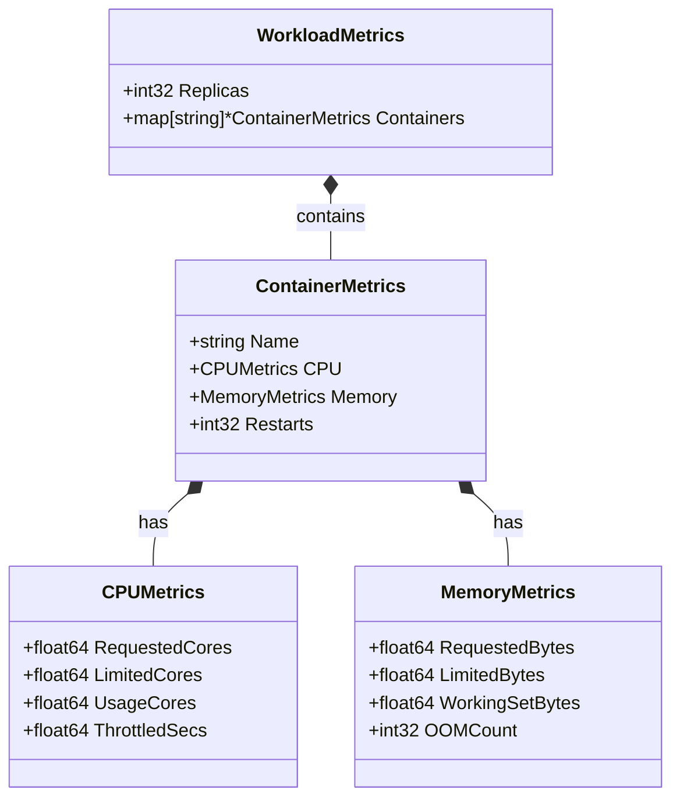

# Telemetry Subsystem V2

## Introduction & Why V1 Was Insufficient

The original V1 implementation aggregated CPU and Memory metrics at the `Workload` (Pod) level. While simple, this architecture contained a critical flaw for an optimization platform: Kubernetes applies resource `requests` and `limits` at the **Container** level.

If an Optimization Engine attempted to right-size a Deployment based on V1's pod-level aggregates, it would generate patches that blindly applied the summed metrics to the primary container, while failing to allocate resources to sidecars (e.g., `istio-proxy`, `linkerd-proxy`, `datadog-agent`). This would result in sidecar starvation or total deployment corruption.

**V2 Architecture** shifts the telemetry granularity. It forces the `WorkloadInspector` to execute PromQL queries grouped by container (`by (container)`) and merges the resulting vectors into a structured `map[string]*ContainerMetrics`.

---

## Container-Aware Data Model



---

## PromQL Query Strategy (V2)

Queries now use strict regex to isolate specific workloads and avoid namespace cardinality collisions (e.g., `frontend` vs `frontend-worker`). They also aggressively filter out Kubernetes infrastructural containers (`container!="POD"`, `container!=""`).

### Example: CPU Usage (Max Over Replicas)

To determine the safest baseline, we find the "hottest" instance of a specific container across all replicas over a 5-minute window:

```promql
max(
  rate(
    container_cpu_usage_seconds_total{
      namespace="default",
      pod=~"^frontend-(?:[a-f0-9]+-[a-z0-9]+|[0-9]+|[a-z0-9]{5})$",
      container!="POD",
      container!=""
    }[5m]
  )
) by (container)
```

**Result Vector:**
```json
[
  { "metric": { "container": "app" }, "value": [ 123456, "1.25" ] },
  { "metric": { "container": "istio-proxy" }, "value": [ 123456, "0.15" ] }
]
```

The `WorkloadInspector` parses these vectors and dynamically creates the `ContainerMetrics` map.

---

## Future Extensibility

The `map[string]*ContainerMetrics` foundation ensures that when **Task #4: Engine Loop** is built, the Optimization Engine can iterate over every container. The Engine will be able to:
1. Propose independent recommendations for the `app` container vs the `istio-proxy` sidecar.
2. Filter out specific containers from being optimized (e.g., ignoring `datadog-agent`).
3. Handle single-container and multi-container workloads interchangeably without special-case logic.
